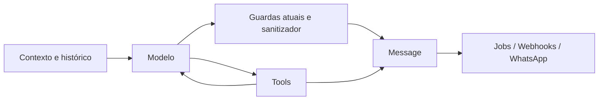
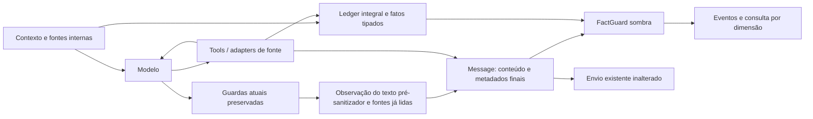

# Ledger de evidência e FactGuard — sombra

Base: `377fdd46d3`. Contrato de implementação aprovado por Paulo em 20/09/2026, a partir de
`spx-os/aprendizados/captain-revisao-adversarial-factual-2026-09-20.md`.

## Modelo e fronteira

`captain_evidence_sources`: conta, conversa, chave de episódio (primeira mensagem da fronteira),
turno, run UUID, origem, nome/versão do adapter, status semântico, resultado integral JSONB,
observed_at/expires_at e digest. O retorno completo da tool fica separado do preview existente.
`captain_evidence_facts`: source_id, mesma fronteira, entidade, aliases explícitos, campo, tipo,
valor canônico, unidade e dependências de derivação. Moeda é Decimal serializado como string;
IDs nunca são convertidos em número. `captain_fact_guard_events`: publicação, estágio, caminho,
conta/agente/episódio/run, tipo de fato, decisão, motivo, cobertura e duração. Eventos não contêm
texto integral de atendimento; referenciam mensagem e digest.

Fontes sem adapter semântico são armazenadas como não verificadas e não autorizam fatos. Resultado
de TTS, memória, FAQ e HTTP genérico não vira preço. Config global de integração não comprova
origem por tenant. Falha de gravação invalida a leitura do run; não é evidência de ausência.

Sem política de validade configurada, evidência nova vale somente no run observado. Reuso entre
turnos exige `fact_guard.validity_seconds` por origem, no config do assistente. Cache sem timestamp
de aquisição verificável fica não verificado. Isso é um default conservador de medição, não uma
decisão comercial sobre validade de preço. Nenhuma política de atendimento fora do horário é
implementada: não há bloqueio nesta entrega.

## Caminho antes

## Caminho com sombra

Leitura: snapshot do ledger restrito à conta/conversa/episódio, nunca coleção global de números.
Observação na criação de Message alcança texto normal, regeneração, handoff e mídias emitidas
durante tools; contexto de execução identifica o caminho. Não equivale a interceptar toda saída
do sistema. Binários, renderização externa de templates, Copilot/Flows fora do contexto Captain e
efeitos em endpoints externos ficam explicitamente fora da validação semântica.

## Ordem, divergência e futura armação

1. Capturar fontes internas e resultados semânticos antes de seu uso.
2. Executar TODAS as guardas existentes, sem mudança de decisão ou tolerância. O sanitizador
   mantém uma cópia do candidato que recebeu e registra a Unit efetivamente lida.
3. Avaliar essa cópia (`pre_sanitizer`) com as mesmas fontes agora disponíveis. É uma comparação
   retrospectiva; guardas anteriores que suprimiram o candidato não aparecem nesse estágio.
4. Avaliar mensagem final em `Message.after_create`, antes de `after_create_commit` enfileirar
   envio (`publication`), inclusive emissões diretas de tools. Registrar também texto `pre_tts`.
5. Enviar normalmente, mesmo se a avaliação falhar. O veredito simulado é `would_block` em
   indisponibilidade; nenhum chamador desta versão o usa para bloquear.

Em divergência, a guarda existente conserva autoridade. Métrica pré/pós identifica correções e
introduções de fatos pelo sanitizador; nunca somar pré/pós como duas mensagens publicadas.
No mínimo 14 dias por tenant/agente/caminho desde a primeira observação utilizável, com taxa de
erros e cobertura reportadas. Não existe switch de armação neste PR. A futura armação exige
decisão explícita e desenho de recuperação; 14 dias sozinhos não autorizam ligar.

Para aposentar guarda específica: corpus dos casos dela e variantes negativos/positivos passando;
amostra estratificada de discordâncias rotulada por humanos; zero falso negativo crítico observado,
limite superior de falso positivo aceitável aprovado; cobertura do campo e caminho daquela guarda
sem `unassessed`; teste de indisponibilidade do ledger e fallback de atendimento aprovado. Guardas
de handoff, dedup e roteamento não são substituídas por verificação de fatos.

## Extração e limites

O comparador de claims tipados é determinístico. A extração de linguagem livre é deliberadamente
parcial e versionada: texto não reconhecido é `unassessed`; claim reconhecida sem entidade ou
campo comprovável é `would_block`, nunca aprovação
semântica da mensagem inteira. Fatos booleanos, completude e citações têm tipos próprios.
O valor do criativo só comprova “o anúncio dizia”; a fala do usuário só comprova “você informou”.
Nenhum deles confirma preço atual de catálogo. Numeração gerada pelo renderer é apresentação.

## Pontos de escrita e operação

| Ponto | Registro e limites |
|---|---|
| `ResponseBuilderJob.perform` | Abre scope por conta/conversa/episódio e UUID por execução, V1 e V2. Regenerações internas compartilham esse run. |
| `BasePublicTool.inherited` / `HttpTool` | Wrapper registra retorno integral, exceção e caminho da tool. Retorno de ação ou tool sem adapter é `unverified`, nunca fato comercial. |
| `BuscarImovelTool.fetch_vista` | Corpo HTTP integral antes de descartar metadata; normalização de propriedades e completude explícita. |
| `PropertyRefContextService.fetch_imovel` | Consulta HTTP nova vira fonte `property_ref`; cache legado sem tempo de aquisição fica `unverified`, mesmo que a nota seja exibida. |
| `ApresentarImoveisTool.fetch_detalhes` / `EnviarLocalizacaoImovelTool.fetch_coordinates` | Corpo integral e fatos tipados antes de renderizar; não certifica foto, título truncado, geocoding ou pin do bairro. |
| `BuscarUnidadesTool` / `ResponseBuilderJob.unidade_da_conta` | Cadastro efetivamente lido: campos autorizados, telefone, endereço, coordenadas e horário habitual. Versão por digest dos dados lidos. |
| `Agentable.time_awareness` | Agenda e estado de horário comercial como `assistant_record`; isso não comprova que existe humano disponível. |
| Entrada do turno | Relato e criativo, com ID da mensagem, escopo `user_quote` / `ad_quote`. Só valores explicitamente citados podem ser repetidos como citação. |
| `Message.after_create` | Lê snapshot de fatos válidos; grava claim, resultado, IDs de evidência e ID da mensagem. Não lê JSONB integral para comparar. |

Semântica: `complete=true` exige `total` explícito igual à quantidade de linhas retornadas;
zero legítimo exige envelope de paginação com total zero. Quantidade retornada é derivação
determinística das linhas. Taxa positiva não implica condomínio fechado; ausente não vira false.
Somatório exige aluguel e condomínio da mesma entidade/unidade; evento conserva IDs dos operandos.
Arredondamento só pela transformação tipada explícita `digits: 0, mode: half_up`; a extração de
prosa ainda não interpreta aproximações. Não existe tolerância percentual.

Ativação de medição, após aplicar migration: atributo **booleano** da conta
`custom_attributes['captain_fact_guard_shadow'] = true`. Conta sem opt-in não grava eventos.
Não foi ativado em produção. Desativar a medição não altera guardas antigas. A validade entre
runs, se aprovada por fonte, é configurável em `assistant.config['fact_guard']['validity_seconds']`.
Nenhum resultado sem timestamp é rejuvenescido. Não há flag `armed`, caminho de bloqueio nem
fallback comercial novo. Futuro gate tem de tratar `would_block`/indisponível como recusa de
publicação e resolver `unassessed` via saída estruturada; não transformar ausência de evento em allow.

Consulta entregue: [captain-factguard-metrics.sql](captain-factguard-metrics.sql), read-only,
parametrizada por `:account_id`. Taxa usa publicações avaliadas por tipo; `coverage` aparece
separadamente. Não misturar `pre_sanitizer`, `pre_tts` e `publication` no denominador.
Publicação aqui significa mensagem persistida/tentativa de envio; não confirma entrega/ACK no
WhatsApp. Eventos gravados no callback compartilham a transação de Message; log independente
pode registrar uma tentativa cuja transação posteriormente sofreu rollback.
Eventos `shadow.fact_guard.captain` também saem por `ActiveSupport::Notifications` e log JSON,
incluindo indisponibilidade do próprio banco. O painel SQL sozinho não mede essa indisponibilidade.
Consumo por coletor de logs já disponível na instalação; nenhuma dependência de SaaS nova.

## Custos e latência

Zero chamadas adicionais de LLM/TTS/HTTP. Escritas de fatos e eventos usam INSERT em lote; cada
fonte nova faz INSERT de source e um de facts, mais transação/savepoint. Cada observação faz duas
leituras (metadata de sources + facts) e um INSERT de eventos. A fronteira do episódio é resolvida
uma vez por execução; essa resolução usa o segmentador existente e depende do tamanho do histórico.
O Unit lookup pode adicionar uma leitura de horário habitual. Normalização/comparação é CPU local,
aproximadamente O(claims × fatos válidos do episódio). Não há busca numérica global.

Estimativa de planejamento, não benchmark de produção: com 2 consultas, 50–100 fatos e 2 observações,
esperar dezenas de operações SQL/transação e ordem de 10–50 ms adicionais com PostgreSQL próximo
e aquecido. Meça p95 real no evento de telemetry (inclui gravação); `duration_ms` no SQL é só
extração/leitura/comparação anterior ao INSERT. Latência de lock/conexão pode superar isso: usa os
timeouts existentes do pool/statement. Sombra não garante latência constante durante outage.

Com 100 KB de dados novos por turno e 10 mil turnos/dia: ~1 GB/dia, ~14 GB em duas semanas,
antes de índices, WAL, réplicas e backup. O envelope guarda corpo bruto e JSON interpretado;
esse custo já deve entrar nos KB medidos, não contar só o preview. Deixa de ser barato ao exceder
~1 MB/turno (~10 GB/dia nesse volume), p95 adicional de 50 ms, ou milhares de fatos válidos por
episódio: revisar adapters, validade, índices e arquivamento. Esses são limites de investigação
propostos, não corte silencioso nem truncamento do ledger. Não foi implementado purge automático;
retenção/acesso devem seguir a política de dados da instalação antes de habilitar volume amplo.

Medição local em 20/09/2026, Ruby 3.4.4/Docker: 30 repetições, 10 claims válidas, fatos sintéticos
em memória, somente `FactGuard.evaluate` (sem banco, extractor, scope ou INSERT):

| Fatos no snapshot | Mediana | p95 |
|---|---:|---:|
| 50 | 0,437 ms | 0,914 ms |
| 1.000 | 9,896 ms | 21,990 ms |
| 10.000 | 120,123 ms | 133,971 ms |

Esses números não são SLO de produção; confirmam que o scan por claim deixa de ser barato em
snapshots grandes. Esse benchmark não mede latência da rede/banco nem fornece taxa de erro factual.
Uma amostra muito pequena dos eventos dos testes de integração (n=6, Docker/Windows, incluindo
INSERT) teve mediana 51,9 ms e p95 amostral 81,1 ms. Portanto o alvo proposto de 50 ms **não foi
demonstrado neste ambiente**; verificar banco/pool e medir com volume representativo antes de
ampliar o opt-in. Não usar o benchmark de CPU para esconder o custo da persistência síncrona.

## Harness e CI

`spec/enterprise/services/captain/evidence/` contém contrato, integração com PostgreSQL/Message e
replay de HTTP real via WebMock. Fixtures têm `schema_version`, proveniência, entrada, filtro,
sequência de respostas HTTP e candidatos do modelo com decisão binária esperada. Sem API real,
sem avaliação de segundo LLM, sem esperar backoff de rede. Positivos exigem claims não vazias;
exemplos que só bloqueiam tudo falham. Não se autoriza fato com HTTP 500, body vazio ou tool errada.

Para novas conversas gravadas: exportar ID/episódio pseudonimizado, prompt/config/adapter versionados,
ordem e argumentos normalizados das tools, status, corpo integral, timestamps/cache/completude e
saídas de modelo de cada tentativa; remover credenciais, cookies e dados pessoais antes do commit.
Mockar HTTP por **método + operação + argumentos**, preservando sequência e número de chamadas;
inesperado falha via WebMock. Congelar relógio nos testes de validade/reabertura e scriptar scheduler
nos de corrida. Mockar transporte final como sink; conferir eventos e persistência independentemente
do texto. Casos de origem sem corpo completo são `reconstructed`, não replay fiel. Nesta entrega
os dois IDs históricos motivam reconstruções; nenhum acesso/exportação de conversa real foi feito.

CI separado em `.github/workflows/factguard-shadow.yml`, com Enterprise presente, Ruby do repo,
PostgreSQL pgvector e Redis. Executa migration/schema e specs novas + regressão do PropertyRef.
Comando local equivalente: `bundle exec rspec spec/enterprise/services/captain/evidence
spec/enterprise/services/captain/property_ref_context_service_spec.rb` (em uma linha).

## Exclusões e exposição residual por caminho

**Nada nesta entrega bloqueia.** Nem o evento `would_block` evita o envio hoje. Não foi feita a
separação preparar/enviar para mídia e ações; esta entrega usa a alternativa de cobertura parcial
explicitamente permitida por Paulo. A tabela mapeia as superfícies do inventário anterior, sem
alegar que o callback de Message substitui mediação dos transportes.

| Superfície do inventário | Cobertura efetiva / exposição residual |
|---|---|
| Resposta V2 e V1 | Texto publicado observado no job Captain. V1 não tem adapter semântico para SearchDocumentation: fatos comerciais dessa origem ficam sem prova. |
| Prompt/config/cenários/campanha | Só fontes internas listadas acima são autorizadas. Outras afirmações continuam prosa sem evidência; gramática não cobre qualquer regra comercial. |
| Histórico/reply antigo/resumos/notas de tools | Nunca alimentam fatos comerciais; referência de entidade implícita pode gerar falso positivo e precisa reconsulta/renderer. |
| Imagem/PDF/transcrição do usuário | Conteúdo visual/áudio não é autorizado como catálogo. OCR, transcrição e fatos sem dinheiro das citações ainda não extraídos. |
| Ficha por Ref/link | HTTP fresco tem adapter. Cache 6h legado não comprova frescor. A validação antiga de domínio por substring continua existente; não corrige autoria de URL. |
| Falha/parcial/erro/tool errada | Negativos reconhecidos são medidos. Outros endpoints sem schema ficam `unverified`; sucesso HTTP genérico não é sucesso semântico. |
| Regeneração/fallback de output | Texto final medido; não há prova de que veio do subrun correto, nem fencing da concorrência existente. |
| Handoff | Texto observado com caminho `handoff`; sucesso da transferência e promessa de humano não são certificados. Candidatos suprimidos por guardas anteriores ao sanitizador não entram nessa comparação. |
| Sanitizador de endereço/link | Unit efetivamente lida é fonte legítima. Apenas claims tipadas reconhecidas são comparadas; endereço livre, abreviações e destino de URL ainda exigem renderer/adapter. |
| Áudio | Texto de entrada ao TTS e texto persistido observados. Bytes do áudio, pronúncia/valor falado e hash texto→mídia não certificados. |
| Fotos/cards | Textos, títulos, subtítulos e descrições visíveis inspecionados; índices do renderer ignorados. Entidade/field ausentes num card ficam sem prova. Foto errada, texto na imagem, botões/URL, conteúdo truncado ou transformação posterior do canal não certificados. |
| Localização | HTTP de detalhes armazenado; coordenada em claim textual tipada é comparável. Anexo de pin, centroide do bairro/geocoding e título físico ainda `unassessed`. |
| Peça/PDF | Evento de mídia identifica lacuna; conteúdo binário, versão do ativo, links e dados comerciais dentro do documento não certificados. |
| Outra conversa/número | `destination_context_mismatch` em telemetry; não reutiliza ledger da origem para aprovar destino. Mensagem no destino continua enviada. |
| Copilot/flows/templates/webhook/WAHA fora do job | Fora de Context.scope: não observados por este PR. Transporte pode transformar conteúdo após evento; ainda não há outbox mediada global. |
| Endpoint externo opaco | Corpo completo registrado, sem autorização semântica. Endpoint pode enviar por conta própria fora do Message local; este ledger não intercepta esse efeito. |
| Execução paralela/retry | CurrentAttributes é isolado por execução local, não propaga automaticamente para nova thread/job. Sem claim durável/fencing; fontes tardias em outro contexto ficam fora. |

`unassessed` em toda prosa livre é deliberado: os padrões atuais não demonstram ausência de outras
afirmações factuais. Universalidade de uma busca só é comparada ao escopo registrado; linguagem
livre pode mudar o filtro alegado sem a gramática perceber. Várias consultas diferentes no mesmo
run tornam o query_id implícito ambíguo, não escolhem silenciosamente a última.

Futura aposentadoria por guarda: link exige entidade + URL com origem/validade e retirada da
tolerância de 2% somente nesse domínio; endereço exige renderização de campos Unit completos;
fotos/cards exigem manifesto versionado/hash de ativos e isolamento por episódio; restrições de
áudio exigem prova do texto sintetizado e cobertura do áudio; promessas/handoff exigem estado de
ação confirmado. Dedup/roteamento/horário são políticas distintas e **não são candidatas** a
aposentadoria por este FactGuard. Para cada candidata, aplicar os critérios de 14 dias, corpus e
discordâncias acima. Não há autorização automática nem decisão de recuperação fora de horário.

## Validação e estado da entrega — 20/09/2026

- Base exata `377fdd46d3`, branch local `PauloSeze/factguard-shadow`, worktree Orca isolado.
- Rodada ampliada: 171 exemplos, zero falhas (evidência, PropertyRef, HTTP, cards, localização,
  unidades, job de resposta e correção de endereço).
- Rodada final após esquema definitivo: 60 exemplos, zero falhas; 25 do corpus novo, mais
  PropertyRef e HTTP. JSON de execução local em `tmp/factguard-rspec.json` (não versionado).
- Migration final criada, removida e recriada em PostgreSQL pgvector 16 descartável. Chaves
  estrangeiras compostas e cascatas verificadas; schema preserva triggers/extensões existentes.
- RuboCop: 16 arquivos novos de Ruby/spec/migration sem ocorrências; HTTP, credentials,
  Message e unidades também verificados sem ocorrências. Hotspots legados dos outros arquivos
  ainda têm ocorrências preexistentes de tamanho/complexidade; não houve refatoração geral.
- SQL de métricas executado com sucesso no banco de teste. Workflow de CI entregue; execução
  remota depende de publicar a branch/abrir PR e não foi realizada aqui.
- Nenhum deploy, push, arming ou opt-in em conta real. Nenhuma guarda anterior aposentada.
- Arena: projeto `64a9aa28-b811-4aa3-b832-4a74157a0842`; documentação técnica é a fonte canônica
  desta implementação. `.codex/` é cache local ignorado pelo repositório.

Próximo passo proposto: revisão da branch e planejamento de rollout da migration + opt-in
restrito para medição; pelo menos duas semanas e as aprovações descritas antes de discutir
armação. Cobertura de binários, produtores externos e recuperação de atendimento permanece
trabalho futuro, explicitamente separado desta entrega em sombra.
